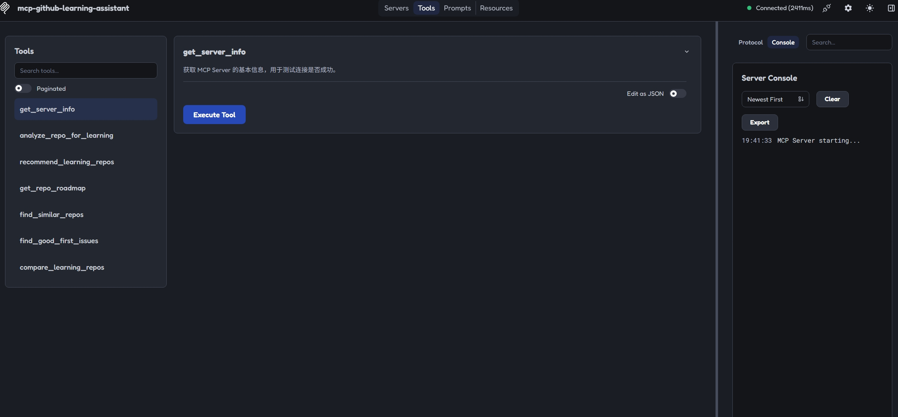
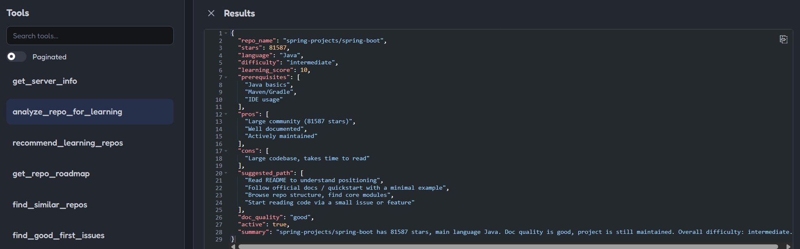

# MCP GitHub Learning Assistant

An MCP (Model Context Protocol) server that helps developers discover and learn from open-source projects on GitHub, based on their skill level and goals.

## Features

7 tools to support every stage of open-source learning:

| Tool | Description |
|------|-------------|
| `analyze_repo_for_learning` | Score a repo: stars, doc quality, difficulty, prerequisites, suggested learning path |
| `recommend_learning_repos` | Curated recommendations per tech stack (Spring Boot, FastAPI, Vue, React, Electron, HarmonyOS) |
| `get_repo_roadmap` | Generate a step-by-step learning roadmap from a repo's directory structure |
| `find_similar_repos` | Find thematically similar repos (same language/topic) for comparison |
| `find_good_first_issues` | Find beginner-friendly open issues (good first issue / help wanted) |
| `compare_learning_repos` | Compare 2+ candidate repos and suggest which to learn first |

## Screenshots

<!-- Add screenshots here as you capture them -->
| MCP Inspector - Tools list | MCP Inspector - analyze_repo_for_learning result |
|:---:|:---:|
|  |  |

## Installation

```bash
pip install mcp-github-learning-assistant
```

## Configuration

Set your GitHub Personal Access Token:

```powershell
# Windows PowerShell
$env:GITHUB_TOKEN = "your_github_token"
```

```bash
# Linux / macOS
export GITHUB_TOKEN=your_github_token
```

Token scope: fine-grained PAT with no special permissions (public repo read-only) is enough.

## Usage in MCP Clients

### MCP Inspector (development)

```bash
npx @modelcontextprotocol/inspector python -m mcp_github_learning_assistant
```

### Cherry Studio

1. Open Cherry Studio, go to Settings -> MCP
2. Add an MCP server with the command `python -m mcp_github_learning_assistant`
3. Set the environment variable `GITHUB_TOKEN`

## Development

```bash
git clone https://github.com/iyiook333/mcp-github-learning-assistant.git
cd mcp-github-learning-assistant
pip install -e .[dev]
pytest
```

## License

MIT